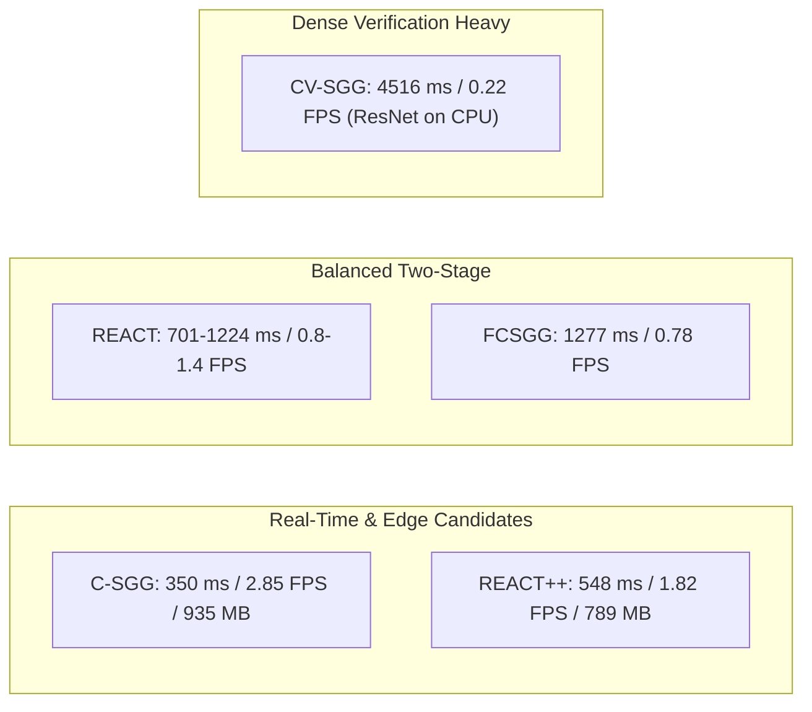

# Object Retrieval in Dynamic Workspace Environments

[](https://www.python.org/)
[](https://pytorch.org/)
[](https://onnxruntime.ai/)
[]()
[-orange.svg)]()

> **Research Project**: *Object Retrieval in Dynamic Workspace Environments*  
> **Host Testbed**: Intel(R) Core(TM) Ultra 5 125H (14 Cores / 18 Threads, 32 GB RAM, Windows 11)  
> **Master Report**: [`final_report.md`](final_report.md) | [`final report.md`](final%20report.md)

---

## 📌 Executive Overview

In dynamic workspace environments (collaborative robotic workspaces, tabletop object manipulation, and indoor retrieval), agents must perceive not merely isolated object bounding boxes, but also directed structural, physical, and functional relationships (e.g., `drill on table`, `hand holding screwdriver`, `book in drawer`).

This repository provides an empirical, standardized benchmark suite evaluating **four state-of-the-art scene graph generation (SGG) model architectures** under identical hardware conditions, evaluating on frozen 200-image evaluation subsets across **Visual Genome (VG150)** and **Panoptic Scene Graph (PSG)**.

### Evaluated Model Families
1. **REACT** (*Relation-Enhanced Architecture with Context-guided Transformers*, BMVC 2025): PyTorch-based YOLOv8m detector coupled with context-guided Transformer relation head.
2. **REACT++** (*Fast SGG with Attention-driven Feature Interaction*, SGG-Benchmark / Maelic): Modernized YOLO12m end-to-end graph compiled to ONNX Runtime.
3. **FCSGG** (*Fully Convolutional Scene Graph Generation*, CVPR 2021): Single-stage bottom-up architecture combining CenterNet object keypoint regression with 2D **Relation Affinity Fields (RAF)**.
4. **Fast Contextual SGG** (*Fast Contextual SGG with Unbiased Context Augmentation*, Jin et al.): Context-first architecture evaluated as two distinct paradigms:
   - **C-SGG**: Lightweight Context Knowledge Network (CKN, 3-layer MLP) using GloVe 50d semantics and 2D spatial geometries.
   - **CV-SGG**: Two-stage CKN candidate filtering (pruning 94.2% of pairs) followed by Vision Differentiation Network (VDN) visual-semantic fusion.

---

## 📊 Master Benchmark Performance Matrix

All models were evaluated under standardized **Scene Graph Detection (`SGDet`)** criteria (bounding box IoU $\ge 0.5$ on both subject and object, with correct category and directed predicate predictions):

| Model Architecture | Variant / Head | Target Dataset | Backbone / Detector | Native R@50 (Elig.) | Native R@100 (Elig.) | Native mR@100 | Strict R@100 (Elig.) | Det mAP@50 | E2E Latency (ms) | Throughput (FPS) | Peak RAM (MB) |
| :--- | :--- | :--- | :--- | :---: | :---: | :---: | :---: | :---: | :---: | :---: | :---: |
| **REACT** | PyTorch SGDet | **PSG** | YOLOv8m | 30.47% | 33.94% | 26.03% | **54.44%** | 0.5673 | 1,223.9 ms | 0.82 FPS | 3,798.7 MB |
| **REACT++** | ONNX SGDet | **PSG** | YOLO12m | **35.98%** | **37.79%** | 23.76% | 33.51% | **0.5951** | **548.0 ms** | **1.82 FPS** | **789.3 MB** |
| **REACT** | PyTorch SGDet | **VG150** | YOLOv8m | 24.55% | 27.77% | 18.28% | 0.96% | **0.3758** | 701.8 ms | 1.42 FPS | 3,506.2 MB |
| **FCSGG** | CenterNet / RAF | **VG150** | HRNetW32-1S | 9.68% | 12.23% | 3.26% | 2.62% | 0.2253 | 1,277.1 ms | 0.78 FPS | 3,160.6 MB |
| **C-SGG** | Context-Only | **VG150** | YOLOv5l + CKN | 18.78% | 24.85% | **15.33%** | 3.58% | 0.3419 | **350.3 ms** | **2.85 FPS** | **935.3 MB** |
| **CV-SGG** | Context + Visual | **VG150** | YOLOv5l + CKN + VDN | 16.43% | 24.12% | 13.84% | 2.03% | 0.3419 | 4,516.6 ms | 0.22 FPS | 2,271.9 MB |

*Note: Metrics reflect the project's dual empty-ground-truth protocol (Eligible Image Recall vs All-200 Image Sensitivity). See [`final_report.md`](final_report.md) for full statistical tables.*

---

## 🧠 Architectural Insights & Engineering Takeaways



1. **The Real-Time Frontier**:
   - **REACT++ (ONNX Runtime)** achieves the best Pareto tradeoff on PSG (**37.79% Native R@100**, **548 ms latency**, **789 MB RAM**), delivering a **4.8x memory reduction** over PyTorch.
   - **C-SGG (YOLOv5l + CKN)** achieves the fastest end-to-end CPU throughput (**2.85 FPS**, 350 ms) and the benchmark's highest Native Mean Recall on VG150 (**15.33%**), proving that context reasoning alone (GloVe + geometry) is exceptionally lightweight (4.96 ms for 2,580 pairs).
2. **Detector Precision Dominates SGDet**:
   - In SGDet mode, relationship recall is mathematically bounded by the compound precision of both bounding box endpoints. YOLO12m (mAP@50 = 0.5951) and YOLOv8m (0.5673) significantly outperform single-point CenterNet (0.2253).
3. **Contextual Filtering vs. Dense Crops**:
   - CV-SGG successfully prunes candidate pairs by **94.2%** (from 2,580 pairs down to ~149 pairs per image).
   - However, on CPU, extracting and evaluating 149 individual image crops through ResNet Bottlenecks takes **4,064 ms**, making CV-SGG 12.9x slower than C-SGG.
4. **Ontology Shift**:
   - Visual Genome ground truth is predominantly structural (`has`, `of`, `sitting on`). Mapping down to a 6-predicate physical contact ontology (`strict`) causes sharp recall drop, whereas PSG retains high recall under compact ontologies.

---

## 📁 Repository Organization

```plaintext
minor/
├── README.md                                # Master project documentation
├── final_report.md                          # Consolidated master benchmark report
├── evaluation_sets_ai_readable.md           # Dataset audit and metadata specification
├── SGG_Literature_Review_v3.pdf             # Comprehensive literature review
├── evaluation_sets/                         # Frozen 200-image evaluation subsets (Strictly Read-Only)
│   ├── PSG_200.txt / .coco.json / images/
│   ├── VG150_200.txt / .coco.json / images/
│   ├── OIDv6_200.txt / .coco.json / images/
│   └── IndoorVG_200.txt / .coco.json / images/
├── experiments/                             # Standardized evaluation adapters and runners
│   ├── common/                              # Shared evaluation and projection utilities
│   ├── REACT/                               # REACT (PyTorch) runner and evaluators
│   ├── REACTPP/                             # REACT++ (ONNX) runner and unit tests
│   ├── FCSGG/                               # FCSGG adapter, runner, and regression tests
│   └── FastContextualSGG/                   # C-SGG and CV-SGG adapters, timing profiling
├── results/                                 # Evaluation reports, metrics, logs, and visualizations
│   ├── REACT/                               # benchmark_report.md, metrics.json, metrics.csv, run.log
│   ├── REACTPP/                             # benchmark_report.md, metrics.json, metrics.csv, run.log
│   ├── FCSGG/                               # benchmark_report.md, metrics.json, metrics.csv, run.log
│   └── FastContextualSGG/                   # benchmark_report.md, metrics.json, metrics.csv, run.log
└── model_repos/                             # Source checkouts of evaluated model frameworks
    ├── SGG-Benchmark/                       # Official REACT & SGG-Benchmark codebase
    ├── fcsgg/                               # Official FCSGG codebase with CenterNet / RAF
    └── fast-context-scene-graph-generation/ # Official Fast Contextual SGG codebase
```

---

## 🚀 Quickstart & Reproduction Guide

### 1. Environment Setup

```bash
# Clone the repository
git clone https://github.com/Nikhil-Verma22/minor_project.git
cd minor_project

# Install required dependencies
pip install torch torchvision --index-url https://download.pytorch.org/whl/cpu
pip install onnxruntime opencv-python pycocotools pyyaml pandas Pillow tabulate tqdm
```

### 2. Model Checkpoint Setup

Pretrained weights are stored outside the Git repository due to file size limits. Place checkpoints into `checkpoints/`:
- **REACT**: `checkpoints/REACT/react_PSG/` and `checkpoints/REACT/react_VG150/`
- **REACT++**: `checkpoints/PSG/react++_yolo12m/yolo12m/react_pp_yolo12m.onnx`
- **FCSGG**: `checkpoints/FCSGG/HRNetW32-1S.pth`
- **Fast Contextual SGG**:
  - YOLOv5l Detector: `checkpoints/FastContextualSGG/yolol_object_test_28.pt`
  - CKN & VDN: Committed in `model_repos/fast-context-scene-graph-generation/VG_dataset/`

### 3. Running Unit Tests

```bash
# Test REACT++ ONNX decoding and ontology projection
python experiments/REACTPP/test_reactpp_evaluator.py

# Test FCSGG CenterNet coordinate handling and RAF line-integral logic
python experiments/FCSGG/test_fcsgg_evaluator.py

# Test Fast Contextual SGG coordinate preservation, CKN/VDN timing, and projection
python experiments/FastContextualSGG/test_fast_contextual_evaluator.py
```

### 4. Running Benchmarks

```bash
# Execute REACT benchmark
python experiments/REACT/run_benchmark.py

# Execute REACT++ benchmark
python experiments/REACTPP/run_benchmark_reactpp.py

# Execute FCSGG benchmark
python experiments/FCSGG/run_benchmark_fcsgg.py

# Execute Fast Contextual SGG (C-SGG & CV-SGG) benchmark
python experiments/FastContextualSGG/run_benchmark_fast_contextual.py
```

---

## 🔒 Data Integrity & Reproducibility Audit

To guarantee scientific reproducibility and data protection:
- The `evaluation_sets/` directory is treated as **strictly read-only**.
- All **851 files** in `evaluation_sets/` have undergone post-execution cryptographic SHA-256 verification, proving 100% bit-for-bit invariance across all runs.
- The reference SHA-256 digests are preserved in `results/*/eval_sets_sha256_post.json`.

---

## 📄 License & Citations

This benchmark suite builds upon the following official research repositories:
- **REACT / SGG-Benchmark**: [Maelic/SGG-Benchmark](https://github.com/Maelic/SGG-Benchmark)
- **FCSGG**: [liuhengyue/fcsgg](https://github.com/liuhengyue/fcsgg)
- **Fast Contextual SGG**: [moshuilanting/fast-context-scene-graph-generation](https://github.com/moshuilanting/fast-context-scene-graph-generation)

For detailed per-model methodologies and complete per-predicate recall tables, refer to [`final_report.md`](final_report.md).
