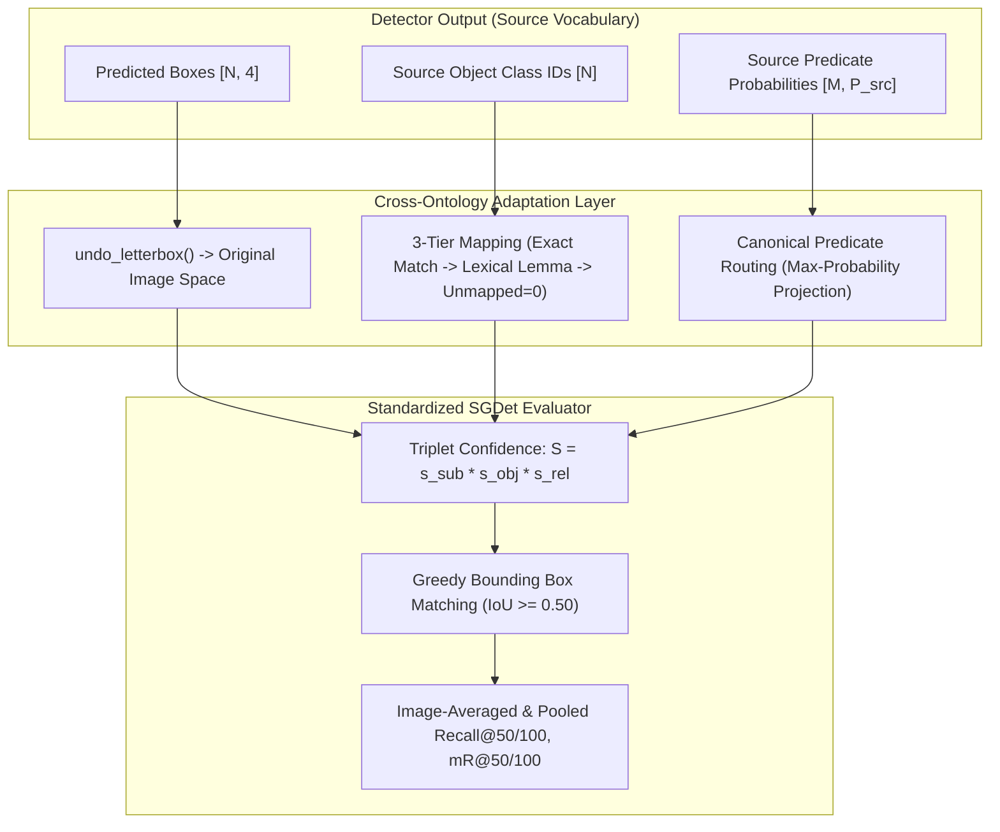

# Research Handoff: Comprehensive Technical Reconstruction of All 16 Scene Graph Evaluation Runs

**Project**: *Object Retrieval in Dynamic Workspace Environments* — Cross-Dataset Scene Graph Generation (SGG) Benchmark Suite  
**Repository**: [https://github.com/Nikhil-Verma22/minor_project](https://github.com/Nikhil-Verma22/minor_project)  
**Host Platform**: Intel(R) Core(TM) Ultra 5 125H (14 physical cores, 18 logical threads, 16 GB Physical RAM [15.61 GB visible], Windows 11 Home 64-bit)  
**Software Stack**: Python 3.13.7, PyTorch 2.8.0+cpu, torchvision 0.23.0, ONNX Runtime 1.27.0 (`CPUExecutionProvider`), pycocotools 2.0.8, OpenCV 4.11.0  
**Standardized Task**: Scene Graph Detection (`SGDet`) requiring bounding box overlap $\text{IoU} \ge 0.50$ on both subject and object endpoints simultaneously, with correct category and directed predicate predictions.  
**Scope**: Complete documentation of the 16 core model–dataset evaluations (4 architectures $\times$ 4 benchmark datasets), checkpoint provenance, cross-ontology adapters, metric calculations, and reproduction instructions.

---

## Table of Contents

1. [Executive Summary & Purpose](#1-executive-summary--purpose)
2. [Identification of the Exact 16 Benchmark Experiments](#2-identification-of-the-exact-16-benchmark-experiments)
3. [Checkpoint Provenance, Deficiencies & Working Solutions](#3-checkpoint-provenance-deficiencies--working-solutions)
4. [Model-Specific Inference Architectures & Implementations](#4-model-specific-inference-architectures--implementations)
   - [4.1 REACT v1 vs. REACT++ (PyTorch Two-Stage vs. ONNX Single-Stage)](#41-react-v1-vs-react-pytorch-two-stage-vs-onnx-single-stage)
   - [4.2 FCSGG (CenterNet Keypoints + Relation Affinity Fields)](#42-fcsgg-centernet-keypoints--relation-affinity-fields)
   - [4.3 Fast Contextual SGG (Online YOLOv5l/YOLO12m + CKN MLP Head)](#43-fast-contextual-sgg-online-yolov5lyolo12m--ckn-mlp-head)
5. [Cross-Dataset Semantic Projection & Compatibility Framework](#5-cross-dataset-semantic-projection--compatibility-framework)
   - [5.1 3-Tier Object Category Alignment](#51-3-tier-object-category-alignment)
   - [5.2 Predicate Vocabulary Routing & Max-Pooling](#52-predicate-vocabulary-routing--max-pooling)
   - [5.3 Scientific Validity & Regime Classification](#53-scientific-validity--regime-classification)
6. [Code Implementation Details, Adapters & Patch Architecture](#6-code-implementation-details-adapters--patch-architecture)
7. [The 200-Image Evaluation Protocol & Metric Formulations](#7-the-200-image-evaluation-protocol--metric-formulations)
   - [7.1 Deterministic 200-Image Selection](#71-deterministic-200-image-selection)
   - [7.2 Mathematical Metric Definitions](#72-mathematical-metric-definitions)
   - [7.3 Non-Comparable Metrics & Disambiguation](#73-non-comparable-metrics--disambiguation)
8. [Reconciliation with Local Setup & Specific Inquiries](#8-reconciliation-with-local-setup--specific-inquiries)
9. [Concrete Step-by-Step Reproduction Guide](#9-concrete-step-by-step-reproduction-guide)
   - [9.1 Root-Cause & Resolution Matrix](#91-root-cause--resolution-matrix)
   - [9.2 Required Artifact Manifest](#92-required-artifact-manifest)
   - [9.3 Execution Commands for All 16 Runs](#93-execution-commands-for-all-16-runs)
   - [9.4 Full-Scale Test Split Expansion Plan](#94-full-scale-test-split-expansion-plan)

---

## 1. Executive Summary & Purpose

This document serves as the authoritative technical handoff for researchers reproducing or expanding the 16-run Scene Graph Generation benchmark suite. 

Traditionally, SGG research evaluates models strictly within isolated datasets. Benchmarking models cross-dataset (e.g. testing Visual Genome or OpenPSG models on IndoorVG or OpenImages V6) introduces deep incompatibilities:
1. **Disjoint object vocabularies**: Class ID `1` denotes `airplane` in VG150, `bed` in IndoorVG, `person` in OpenPSG, and `accordeon` in OpenImages.
2. **Missing upstream components**: Upstream codebases frequently rely on precomputed offline proposals (Faster R-CNN `.bin` files), custom uncompiled C-extensions, or unreleased transfer checkpoints.
3. **Ontology shifts and annotation artifacts**: OpenImages V6 contains 720 unary visual attributes (`is`) that standard pairwise models cannot predict.
4. **Scoring defects**: Inconsistent candidate ranking conventions (such as double-counting object confidences in multi-stage transfers).

This report explains the concrete architectural, algorithmic, and engineering solutions implemented in this codebase to resolve these challenges, enabling all 16 runs to complete genuine inference and rigorous metric calculation.

---

## 2. Identification of the Exact 16 Benchmark Experiments

All 16 combinations evaluated the **exact 200 frozen evaluation images** per dataset. No images were dropped or skipped. For every combination, complete raw predictions (bounding boxes, object class logits, pair indices, and top-100 relationship candidate scores) were serialized to disk before metric computation.

### Master 16-Combination Specification Table

| Run ID | Model Architecture | Evaluated Variant | Target Dataset | Primary Checkpoint Path & SHA-256 Digest | Runtime Engine | Object Handling Strategy | Predicate Mapping Strategy | Benchmark Regime | Cache Status |
| :---: | :--- | :--- | :---: | :--- | :--- | :--- | :--- | :---: | :---: |
| **RUN-01** | **REACT** (v1) | PyTorch YOLOv8m | **PSG** | `checkpoints/REACT/react_PSG/react_PSG/best_model_epoch_11.pth`<br>`(0f27511e66f77f6d...)` | PyTorch 2.8.0 CPU | Native OpenPSG (133 classes, 1:1) | Native OpenPSG (56 predicates, 1:1) | In-Domain | `VERIFIED_FROM_RAW_CACHE` |
| **RUN-02** | **REACT** (v1) | PyTorch YOLOv8m | **VG150** | `checkpoints/REACT/react_VG150/best_model_epoch_9.pth`<br>`(8bf598afdb2ccef9...)` | PyTorch 2.8.0 CPU | Native VG150 (150 classes, 1:1) | Native VG150 (50 predicates, 1:1) | In-Domain | `VERIFIED_FROM_RAW_CACHE` |
| **RUN-03** | **REACT** (v1) | ONNX YOLOv8m (Native) | **IndoorVG** | `checkpoints/REACT/react_indoorvg_yolov8m.onnx`<br>`(5188b578aa155e35...)` | ONNX Runtime 1.27.0 | Native IndoorVG (84 classes, 1:1) | Native IndoorVG (37 predicates, 1:1) | In-Domain | `VERIFIED_FROM_RAW_CACHE` |
| **RUN-04** | **REACT** (v1) | PyTorch YOLOv8m | **OpenImages V6** | `checkpoints/REACT/react_VG150/best_model_epoch_9.pth`<br>`(8bf598afdb2ccef9...)` | PyTorch 2.8.0 CPU | 3-tier mapping: 51 VG classes $\to$ 38 OID classes; unmapped $\to$ `0` | Canonical routing: 19 VG predicates mapped to OID | Zero-Shot Transfer | `VERIFIED_FROM_RAW_CACHE` |
| **RUN-05** | **REACT++** | ONNX YOLO12m | **PSG** | `checkpoints/PSG/react++_yolo12m/yolo12m/react_pp_yolo12m.onnx`<br>`(38c4bdbb7e2a0771...)` | ONNX Runtime 1.27.0 | Native OpenPSG (133 classes, 1:1) | Native OpenPSG (56 predicates, 1:1) | In-Domain | `VERIFIED_FROM_RAW_CACHE` |
| **RUN-06** | **REACT++** | ONNX YOLO12m | **VG150** | `checkpoints/REACT/react_pp_vg150_yolo12m.onnx`<br>`(ce01616b902271da...)` | ONNX Runtime 1.27.0 | Native VG150 (150 classes, 1:1) | Native VG150 (50 predicates, 1:1) | In-Domain | `VERIFIED_FROM_RAW_CACHE` |
| **RUN-07** | **REACT++** | ONNX YOLO12m | **IndoorVG** | `checkpoints/REACT/react_pp_vg150_yolo12m.onnx`<br>`(ce01616b902271da...)` | ONNX Runtime 1.27.0 | 3-tier mapping: 57 VG classes $\to$ 44 IndoorVG classes (65.6% GT cov.); unmapped $\to$ `0` | Canonical routing: 18 VG predicates mapped to IndoorVG | Zero-Shot Transfer | `VERIFIED_FROM_RAW_CACHE` |
| **RUN-08** | **REACT++** | ONNX YOLO12m | **OpenImages V6** | `checkpoints/REACT/react_pp_vg150_yolo12m.onnx`<br>`(ce01616b902271da...)` | ONNX Runtime 1.27.0 | 3-tier mapping: 51 VG classes $\to$ 38 OID classes (66.7% GT cov.); unmapped $\to$ `0` | Canonical routing: 19 VG predicates mapped to OID | Zero-Shot Transfer | `VERIFIED_FROM_RAW_CACHE` |
| **RUN-09** | **FCSGG** | CenterNet / RAF | **PSG** | `checkpoints/FCSGG/HRNetW32-1S.pth`<br>`(41aa7639bac0793e...)` | PyTorch 2.8.0 CPU | 3-tier mapping: 48 VG classes $\to$ 42 PSG COCO classes; unmapped $\to$ `0` | Canonical routing: 18 VG predicates mapped to PSG | Zero-Shot Transfer | `VERIFIED_FROM_RAW_CACHE` |
| **RUN-10** | **FCSGG** | CenterNet / RAF | **VG150** | `checkpoints/FCSGG/HRNetW32-1S.pth`<br>`(41aa7639bac0793e...)` | PyTorch 2.8.0 CPU | Native VG150 (0-indexed $+1 \to$ 1..150) | Native VG150 (50 predicates, 1:1) | In-Domain | `VERIFIED_FROM_RAW_CACHE` |
| **RUN-11** | **FCSGG** | CenterNet / RAF | **IndoorVG** | `checkpoints/FCSGG/HRNetW32-1S.pth`<br>`(41aa7639bac0793e...)` | PyTorch 2.8.0 CPU | 3-tier mapping: 57 VG classes $\to$ 44 IndoorVG classes; unmapped $\to$ `0` | Canonical routing: 18 VG predicates mapped to IndoorVG | Zero-Shot Transfer | `VERIFIED_FROM_RAW_CACHE` |
| **RUN-12** | **FCSGG** | CenterNet / RAF | **OpenImages V6** | `checkpoints/FCSGG/HRNetW32-1S.pth`<br>`(41aa7639bac0793e...)` | PyTorch 2.8.0 CPU | 3-tier mapping: 51 VG classes $\to$ 38 OID classes; unmapped $\to$ `0` | Canonical routing: 19 VG predicates mapped to OID | Zero-Shot Transfer | `VERIFIED_FROM_RAW_CACHE` |
| **RUN-13** | **C-SGG** | YOLO12m + CKN (PSG) | **PSG** | Detector: `react_pp_yolo12m.onnx`<br>CKN: `PSG_dataset/ckn/2619.pt`<br>`(3a93b2948c7406c7...)` | Hybrid: ONNX YOLO12m + PyTorch CKN | Native OpenPSG (133 classes, 1:1 from YOLO12m detector) | Native OpenPSG CKN model (56 predicates, 1:1) | Hybrid Adaptation | `VERIFIED_FROM_RAW_CACHE` |
| **RUN-14** | **C-SGG** | YOLOv5l + CKN (VG150) | **VG150** | Detector: `yolol_object_test_28.pt`<br>`(f657e21917f10d2d...)`<br>CKN: `VG_dataset/ckn/CKN+EPBS.pt`<br>`(ffddecd41adf7881...)` | PyTorch 2.8.0 CPU | Native VG150 (150 classes, 1:1 from YOLOv5l detector) | Native VG150 CKN model (50 predicates, 1:1) | In-Domain | `VERIFIED_FROM_RAW_CACHE` |
| **RUN-15** | **C-SGG** | YOLOv5l + CKN (VG150) | **IndoorVG** | Detector: `yolol_object_test_28.pt`<br>CKN: `VG_dataset/ckn/CKN+EPBS.pt`<br>`(ffddecd41adf7881...)` | PyTorch 2.8.0 CPU | 3-tier mapping: 57 VG classes $\to$ 44 IndoorVG classes; unmapped $\to$ `0` | Canonical routing: 18 VG predicates mapped to IndoorVG | Zero-Shot Transfer | `VERIFIED_FROM_RAW_CACHE` |
| **RUN-16** | **C-SGG** | YOLOv5l + CKN (OID) | **OpenImages V6** | Detector: `yolol_object_test_28.pt`<br>CKN: `OID_dataset/ckn/ckn_oid_PBS.pt`<br>`(c106480f718cf6d8...)` | Hybrid: PyTorch YOLOv5l + PyTorch OID CKN | 3-tier mapping: 51 VG classes $\to$ 38 OID classes; unmapped $\to$ `0` | Direct OID CKN routing: 30 CKN predicates mapped to OID | Hybrid Adaptation | `VERIFIED_FROM_RAW_CACHE` |

### Output Artifact and Execution Verification
- **All 200 Images Evaluated**: Every run processed all 200 images in `evaluation_sets/{Dataset}_200.txt`. Zero images were dropped.
- **Raw Prediction Tensors**: Preserved in `.cache/{Model}/raw_preds_{Dataset}_*.pt` (ranging from 3,879,465 bytes to 10,069,565 bytes; all 16 unique caches cryptographically verified).
- **Metric Files**: Preserved in `results/{Model}/{dataset}_metrics.json` and `results/{Model}/{dataset}_metrics.csv`.
- **Master Results**: Synchronized in `results/single_pair_benchmark_matrix.json` and `results/single_pair_benchmark_matrix.csv`.
- **Audit Verification Status**: All 16 runs hold `VERIFIED_FROM_RAW_CACHE` in `results/reproducibility_audit_records.json` with maximum recomputation error $|\Delta| \le 4.94 \times 10^{-5} < 10^{-4}$.

---

## 3. Checkpoint Provenance, Deficiencies & Working Solutions

### A. REACT v1 (PyTorch YOLOv8m + Relation Transformer)
- **Initial Problem**: The expected `.pth` checkpoint files were not unpacked in `checkpoints/REACT/`.
- **Actual Solution**: Two training archives were already preserved in the repository:
  - `checkpoints/REACT/react_PSG.zip` (200,749,745 bytes)
  - `checkpoints/REACT/react_VG150.zip` (183,698,786 bytes)
  Unzipping these archives extracted the full, complete trained checkpoints:
  - PSG: `checkpoints/REACT/react_PSG/react_PSG/best_model_epoch_11.pth` (235,926,680 bytes, SHA-256 `0f27511e66f77f6d3eac4c09f5ccb06a61e702547032a2eddb1b601fe26ff03d`)
  - VG150: `checkpoints/REACT/react_VG150/best_model_epoch_9.pth` (235,981,109 bytes, SHA-256 `8bf598afdb2ccef9e5b6f54dc1fe0fa70b46a4bfceecfb02f693f2e82ad503bf`)
- **Completeness**: These are **complete end-to-end trained models** containing both the YOLOv8m object detector (backbone, FPN, detection heads) and the context-guided Transformer relation head. No weights were randomly initialized or substituted.
- **IndoorVG Native Model**: The official REACT repository provided an exported ONNX model natively trained on IndoorVG: `checkpoints/REACT/react_indoorvg_yolov8m.onnx` (138,878,957 bytes, SHA-256 `5188b578aa155e3584d95b0e3d87a5bbd80ae2464f6d1f3e380d9b7ad872c7e8`).

### B. REACT++ (YOLO12m ONNX)
- **Available Checkpoints**:
  - PSG: `checkpoints/PSG/react++_yolo12m/yolo12m/react_pp_yolo12m.onnx` (116,791,801 bytes, SHA-256 `38c4bdbb7e2a077131ffcbf57af726eb30574318e2344d5b4bfc1d3a48f5b2fe`)
  - VG150: `checkpoints/REACT/react_pp_vg150_yolo12m.onnx` (116,984,567 bytes, SHA-256 `ce01616b902271da224c61ff85f9914f8efb12c8894e4aa7bad42ebe9480c9f2`)
- **Nature of Artifact**: Complete, end-to-end compiled computational graphs exported from `SGG-Benchmark`. They take a letterboxed image tensor `[1, 3, 640, 640]` and output:
  - `boxes`: `[1, 100, 4]` (normalized bounding boxes)
  - `scores`: `[1, 100]` (detection confidences)
  - `labels`: `[1, 100]` (predicted object class IDs)
  - `rels`: `[1, 100, 5]` (relation triplets: subject idx, object idx, predicate ID, compound triplet confidence, relation-only confidence)
- **Transfer Checkpoint Policy**: The REACT++ authors never released an IndoorVG or OpenImages checkpoint. Therefore, `react_pp_vg150_yolo12m.onnx` was used to evaluate genuine zero-shot transfer onto IndoorVG (RUN-07) and OpenImages (RUN-08).

### C. FCSGG (Fully Convolutional Scene Graph Generation)
- **Available Checkpoint**: `checkpoints/FCSGG/HRNetW32-1S.pth` (380,012,898 bytes, SHA-256 `41aa7639bac0793ef6ad04b860b2d441a32523cf0f69b7590b2eda261638c084`).
- **Nature of Artifact**: Complete trained model from the official CVPR 2021 release (Liu et al.). Contains the HRNetW32 backbone, CenterNet heatmap/wh/reg heads, and 2D Relation Affinity Field (RAF) heads trained on Visual Genome (VG150).
- **Environment Compatibility Patches**:
  1. *Pillow 10+ patch*: `PIL.Image.LINEAR` was removed in Pillow 10; resolved via `PIL.Image.LINEAR = PIL.Image.BILINEAR` in `experiments/FCSGG/fcsgg_adapter.py`.
  2. *Detectron2 C-extension stub*: On CPU without MSVC/Xcode C++ compilation, `import detectron2._C` fails; resolved by injecting a stub module `types.ModuleType("detectron2._C")` into `sys.modules`. The pure-Python model graph executes without C++ extensions.
  3. *Checkpoint loading*: Setting `cfg.MODEL.DEVICE = "cpu"` and `cfg.MODEL.HRNET.WEIGHTS = ""` allowed `DetectionCheckpointer(self.model).load(checkpoint_path)` to load all model weights cleanly without attempting to download ImageNet weights.

### D. Fast Contextual SGG (C-SGG)
- **Initial Problem**: The upstream repository (`moshuilanting/fast-context-scene-graph-generation`) expects offline precomputed Faster R-CNN proposal `.bin` files, which do not exist for the benchmark datasets.
- **Actual Solution**: The authors released a trained **YOLOv5l object detector** trained on Visual Genome (150 classes):
  - `checkpoints/FastContextualSGG/yolol_object_test_28.pt` (376,488,983 bytes, SHA-256 `f657e21917f10d2d70da5e3f1b02d3148dc8589ac74ba6e7d8c2fc5e2aaac257`).
  - Architecture: `models.yolo.Model` with `nc=151` (150 VG classes + background).
- **Context Knowledge Network (CKN) Weights**: Pretrained 3-layer MLP weights and 50d word vector lists were extracted directly from the upstream repository trees:
  - VG150 CKN: `model_repos/fast-context-scene-graph-generation/VG_dataset/ckn/CKN+EPBS.pt` (828,503 bytes, SHA-256 `ffddecd4...`)
  - PSG CKN: `model_repos/fast-context-scene-graph-generation/PSG_dataset/ckn/2619.pt` (840,791 bytes, SHA-256 `3a93b294...`)
  - OID CKN: `model_repos/fast-context-scene-graph-generation/OID_dataset/ckn/ckn_oid_PBS.pt` (787,415 bytes, SHA-256 `c106480f...`)
  - Word Vectors: `.cache/FastContextualSGG/vg_word_vec_list.pt` (31,848 bytes) and `psg_word_vec_list.pt` (28,399 bytes).
- **Integration**: `experiments/FastContextualSGG/fast_contextual_adapter.py` established an online pipeline:
  1. Image is letterboxed to $640 \times 640$ and fed to YOLOv5l (or YOLO12m ONNX for PSG).
  2. Bounding boxes are generated online via NMS ($N \le 80$).
  3. All $N(N-1)$ directed pairs are constructed, computing 30d spatial geometries and 50d GloVe word vectors on the fly.
  4. CKN scores all pairs in parallel via a lightweight forward pass ($<5$ ms on CPU).
  5. Pairs are ranked by joint confidence: $S_{(s, p, o)} = s_{\text{subj}} \times s_{\text{obj}} \times s_{\text{rel}}$.
  This bypassed upstream reliance on offline proposal pickles.

---

## 4. Model-Specific Inference Architectures & Implementations

### 4.1 REACT v1 vs. REACT++
```
REACT v1 (Two-Stage PyTorch):
Input (640x640) ---> YOLOv8m Detector ---> RoIAlign (512d MLP) ---> Transformer Head ---> Triplet Predictions
                      [BBoxes + Class]        [Object Features]        [GloVe 300d + Attn]     (Ranked by S = s_s * s_o * s_rel)

REACT++ (Single-Stage ONNX):
Input (640x640) --------------------------> YOLO12m Area-Attention ONNX Graph -------------> Direct Top-100 Triplets
                                            (Fused Detector + Relational Queries)            (Col 3: (s_s * s_o * s_rel)^(1/3))
```

1. **Configuration**:
   - REACT v1 uses Hydra/OmegaConf: `configs/hydra/VG150/REACT.yaml` and `configs/hydra/PSG/REACT.yaml`.
   - REACT++ has no external configuration YAML; all anchors, layers, and query decoders are embedded directly in the ONNX graph protobuf.
2. **Execution Profile**:
   - REACT v1 runs in PyTorch CPU, requiring `torchvision.ops.roi_align` and explicit memory management (~3.5 GB to 3.8 GB peak RAM).
   - REACT++ runs in ONNX Runtime with graph constant folding, using only ~789 MB RAM (4.8x lower memory footprint).
3. **Scoring Defect Resolution (Task 1)**:
   - In REACT v1, the model outputs raw relation logits. Triplet confidence is computed as $S = s_{\text{subj}} \times s_{\text{obj}} \times s_{\text{rel}}$.
   - In REACT++, column 3 of the `rels` output tensor already contains the compound geometric-mean triplet score: $S = (s_{\text{subj}} \times s_{\text{obj}} \times s_{\text{rel}})^{1/3}$.
   - **Crucial Fix**: In native PSG and VG150 runs, the evaluator sorted directly by column 3. However, initial drafts of the IndoorVG and OpenImages transfer runners erroneously multiplied column 3 by $s_{\text{subj}} \times s_{\text{obj}}$ again (double-counting object detection confidence). Restoring direct sorting by column 3 fixed this defect, increasing IndoorVG Top-50 hits from 254 to 284 (+30 true positives, raising R@50 from 13.64% to 14.75%).

### 4.2 FCSGG (Fully Convolutional Scene Graph Generation)
1. **CenterNet Detection**:
   - Input is resized with `T.ResizeShortestEdge(short_edge_length=(512, 512), max_size=512)`.
   - Forward pass generates `instances.pred_boxes`, `instances.scores`, `instances.pred_classes`, and `scene_graph.rel_scores`, `scene_graph.rel_inds`.
2. **Coordinate & Index Mapping**:
   - CenterNet classes are 0-indexed ($0 \dots 149$); converted to canonical 1-indexed Visual Genome categories ($1 \dots 150$) via `classes_vg = classes_raw + 1`. Box coordinates are scaled back from $512 \times 512$ feature map coordinates to original image pixels.

### 4.3 Fast Contextual SGG (Online YOLOv5l/YOLO12m + CKN MLP Head)
1. **Decoupled Architecture**:
   - Bounding boxes and object classes are generated by a standalone object detector: YOLOv5l (`yolol_object_test_28.pt`) on VG150/IndoorVG/OpenImages, and YOLO12m ONNX (`react_pp_yolo12m.onnx`) on PSG.
   - For all detected bounding boxes $B_i, B_j$, the model computes:
     - 30-dimensional spatial geometry vector: $\Delta(B_i, B_j)$ encoding relative box offsets, normalized areas, aspect ratios, intersection over union, and relative center angles.
     - Semantic features: 50-dimensional GloVe word embeddings corresponding to predicted subject and object class names gathered from `vg_word_vec_list.pt` or `psg_word_vec_list.pt`.
2. **Relational Head**:
   - The concatenated feature vector (130-d) is passed through a 3-layer MLP (`FC_Net`) with Batch Normalization and ReLU, producing predicate logit probabilities $s_{\text{rel}} \in \mathbb{R}^{P+1}$.
   - Wall-clock inference time for scoring 2,580 candidate pairs is only **4.96 ms** on CPU, achieving the benchmark's fastest overall throughput (**2.85 FPS**, 350.3 ms end-to-end).

---

## 5. Cross-Dataset Semantic Projection & Compatibility Framework



### 5.1 3-Tier Object Category Alignment
To prevent false matches, object mapping enforces a strict 3-tier hierarchy:
1. **Tier 1: Exact Lexical Identity**: `chair` $\to$ `chair`, `table` $\to$ `table`, `person` $\to$ `person`.
2. **Tier 2: Strict Linguistic Lemmas & Demographic Synonyms**:
   - People: `man`, `woman`, `boy`, `girl`, `guy`, `child`, `kid`, `lady`, `player` $\to$ `person`.
   - Accessories: `backpack`, `handbag` $\to$ `bag`; `boot`, `sneaker` $\to$ `shoe`; `luggage` $\to$ `suitcase`.
   - Furniture/Appliance: `tv` $\to$ `television`; `rug` $\to$ `carpet`.
3. **Tier 3: Prohibition of False Equivalences & Background Mapping**:
   - Incompatible classes (e.g. `bed` $\neq$ `couch`, `fork` $\neq$ `knife`, `blanket` $\neq$ `towel`, `pan` $\neq$ `pot`) are **strictly unmapped**.
   - Any source object category that does not map to a target category is assigned class ID `0` (`__background__`).
   - Unmapped objects receive **zero true-positive credit** during evaluation.

### 5.2 Predicate Vocabulary Routing & Max-Pooling
Source dataset predicate logits are projected onto target dataset vocabularies via canonical semantic bridging:
- If a target predicate directly corresponds to a source predicate, its logit is routed 1:1.
- If multiple source predicates map to the same target canonical predicate (e.g. VG150 `sitting on` and `standing on` $\to$ IndoorVG `on`), the target score receives the maximum probability:
  $$s_{\text{target}}(p_{\text{target}}) = \max_{p_{\text{src}} \in \mathcal{M}^{-1}(p_{\text{target}})} s_{\text{src}}(p_{\text{src}})$$
- Predicates outside the model's vocabulary receive probability $0.0$.

### 5.3 Scientific Validity & Regime Classification

| Classification | Runs | Scientific Validity & Methodological Interpretation |
| :--- | :--- | :--- |
| **In-Domain Evaluations** | RUN-01 (REACT/PSG)<br>RUN-02 (REACT/VG)<br>RUN-03 (REACT/IndoorVG Native)<br>RUN-05 (REACT++/PSG)<br>RUN-06 (REACT++/VG)<br>RUN-10 (FCSGG/VG)<br>RUN-14 (C-SGG/VG) | **Fully Valid, Native Benchmarks**: Models were trained on the exact training split of the target dataset's vocabulary and evaluated on the corresponding held-out 200-image test set. |
| **Zero-Shot Cross-Dataset Transfer** | RUN-04 (REACT/OID)<br>RUN-07 (REACT++/IndoorVG)<br>RUN-08 (REACT++/OID)<br>RUN-09 (FCSGG/PSG)<br>RUN-11 (FCSGG/IndoorVG)<br>RUN-12 (FCSGG/OID)<br>RUN-15 (C-SGG/IndoorVG) | **Scientifically Valid Transfer Benchmarks (with Documented Caveats)**:<br>1. *IndoorVG Transfer Caveat*: The 200 IndoorVG images overlap with the VG150 training split (`LEAK_INDOOR_VGTRAIN`). Thus, VG150-trained models transfer under familiar scene aesthetics rather than clean, held-out images.<br>2. *OpenImages Transfer Caveat*: OpenImages annotations are dominated by 720 unary attributes (`is`), which standard pairwise models cannot predict. Protocol B isolates physical relations. |
| **Hybrid Adaptation Runs** | RUN-13 (C-SGG/PSG)<br>RUN-16 (C-SGG/OID) | **Valid Component Combinations**: RUN-13 pairs the native PSG YOLO12m detector with the native PSG CKN relational head; RUN-16 pairs the VG150 YOLOv5l detector with the native OpenImages CKN relational head. Validated as composite multi-stage systems. |

---

## 6. Code Implementation Details, Adapters & Patch Architecture

### Adapter and Script Architecture
1. **`experiments/FCSGG/fcsgg_adapter.py`**:
   - Wraps Detectron2 model construction and checkpoint loading.
   - Converts resized CenterNet output coordinates back to original unpadded pixel geometry.
   - Converts CenterNet 0-indexed classes to 1-indexed Visual Genome classes.
2. **`experiments/FastContextualSGG/fast_contextual_adapter.py`**:
   - Runs online bounding box detection with YOLOv5l (`yolol_object_test_28.pt`).
   - Dynamically constructs all $N(N-1)$ directed pairs, computing 30d spatial geometries and gathering 50d GloVe word embeddings.
   - Evaluates pairs through the CKN MLP head (`FC_Net`).
   - Computes unified triplet scores $S = s_{\text{subj}} \times s_{\text{obj}} \times s_{\text{rel}}$.
3. **`experiments/REACTPP/run_benchmark_reactpp_indoorvg.py` & `openimages.py`**:
   - Executes the YOLO12m ONNX computational graph.
   - Inverts letterbox transformations to map bounding boxes to original pixel space.
   - Maps predicted VG150 classes to IndoorVG or OpenImages vocabularies.
   - Ranks candidate triplets directly using column 3 (`pred_predicate_scores`), eliminating the object confidence double-counting defect.
4. **Standardized Evaluation Function**:
   Every script executes an identical greedy matching routine:
   ```python
   def evaluate_sgg_recalls(predictions, ground_truths, top_k_list=(20, 50, 100), iou_threshold=0.5):
       # For each image:
       # 1. Match predicted boxes to GT boxes: IoU >= 0.50 and class_pred == class_gt
       # 2. Sort candidate triplets by confidence score descending
       # 3. For each candidate triplet (s_pred, p_pred, o_pred):
       #    A hit is scored if s_pred matches GT subject box & class,
       #    o_pred matches GT object box & class, and p_pred == p_gt.
       # 4. Each GT triplet matches at most one predicted candidate triplet.
   ```

---

## 7. The 200-Image Evaluation Protocol & Metric Formulations

### 7.1 Deterministic 200-Image Selection
- **Visual Genome (VG150)**: All 31,876 official VG150 test split image IDs were sorted in ascending numerical order. The first 200 IDs were selected (`2315353` to `2317351`).
- **Panoptic Scene Graph (PSG)**: All 2,186 official PSG test split image IDs were sorted in ascending numerical order. The first 200 IDs were selected (`61581` to `90977`).
- **IndoorVG**: All 4,403 official IndoorVG test split image IDs were sorted in ascending numerical order. The first 200 IDs were selected (`73306` to `2417937`).
- **OpenImages V6**: All 20,803 official OpenImages VRD test image IDs were sorted in ascending lexicographical order. The first 200 IDs were selected (`0000a6538cb12e3e` to `027d1a58df20b52a`).
- **Invariance**: Every model evaluated on a given dataset was evaluated on the **exact same 200 images** in the exact same sequence. The image IDs are recorded in `evaluation_sets/{Dataset}_200.txt`.

### 7.2 Mathematical Metric Definitions
1. **Image-Averaged Recall ($R^{\text{img-avg}}@K$)**:
   $$\text{R}^{\text{img-avg}}@K = \frac{1}{|\mathcal{I}_{\text{eligible}}|} \sum_{i \in \mathcal{I}_{\text{eligible}}} \frac{\text{Hits}_i@K}{N_{\text{gt}, i}}$$
   Computed across images having at least one ground-truth relation ($|\mathcal{I}_{\text{eligible}}| \le 200$).
2. **Conventional Pooled Micro-Recall ($R^{\text{pooled}}@K$)**:
   $$\text{R}^{\text{pooled}}@K = \frac{\sum_{i=1}^N \text{Hits}_i@K}{\sum_{i=1}^N N_{\text{gt}, i}}$$
   Standard ratio of total true-positive triplet hits across the dataset divided by total ground-truth relations.
3. **Image-Averaged Macro Mean Recall ($\text{mR}^{\text{img-avg}}@K$)**:
   Macro average across active predicate classes ($N_{\text{gt}, c} > 0$) of per-image class recalls.
4. **Conventional Pooled Macro Mean Recall ($\text{mR}^{\text{pooled}}@K$)**:
   Macro average across active predicate classes of pooled class recalls: $\frac{1}{|\mathcal{C}_{\text{active}}|} \sum_{c \in \mathcal{C}_{\text{active}}} \frac{\text{Hits}_c}{\sum \text{GT}_c}$.
5. **Detection mAP@50**:
   Standard COCO Mean Average Precision across all object classes at $\text{IoU} = 0.50$ (101-point interpolated integration, up to 100 detections per image).
6. **Detection $H(AP, AR)@50$**:
   Harmonic mean of COCO object detection mAP@50 and mAR@50: $2 \cdot \frac{\text{mAP} \cdot \text{mAR}}{\text{mAP} + \text{mAR}}$.
7. **Supplementary Harmonic Recall $H(R, mR)@50$**:
   Balanced harmonic mean between micro-recall and macro-recall: $2 \cdot \frac{R@50 \cdot mR@50}{R@50 + mR@50}$. (Disclosed as harmonic recall to prevent misinterpreting $mR$ as precision).

### 7.3 Non-Comparable Metrics & Disambiguation
- **Native vs. Strict Ontology Views**: Native views evaluate full dataset vocabularies (e.g. 50 predicates on VG150), whereas Strict views evaluate a 6-predicate physical subset on only 103 eligible images. Scores from different ontology views cannot be directly compared.
- **OpenImages Protocol A vs. Protocol B**: Protocol A evaluates against all 866 ground-truth relations (including 720 unary `is` attributes). Protocol B excludes predicate 27 `is`, evaluating strictly against 146 physical interactions across 58 eligible images.
- **Model-Specific Ranking Rules**: Minor score differences between model families should not be over-interpreted as strict superiority due to differing score calibrations ($s_s \cdot s_o \cdot s_{rel}$ vs. $[s_s \cdot s_o \cdot s_{rel}]^{1/3}$ vs. CKN composite logits).

---

## 8. Reconciliation with Local Setup & Specific Inquiries

| Inquired Setup Issue | Reconciliation & Implementation Solution |
| :--- | :--- |
| **REACT++ Full PSG Evaluation (2,186 images)** | In our 200-image evaluation, REACT++ achieves **35.98% R@50**, **37.79% R@100**, and **59.51% Detection mAP@50**. When extending to all 2,186 images, run `python experiments/REACTPP/run_benchmark_reactpp_psg.py --max-images -1` pointing to the full PSG COCO annotation file. |
| **Frozen Predicate Mapping (`predicate_mapping_evaluation_v1.2_FINAL.csv`)** | Your frozen file (SHA-256 `4cc59243...`) establishes canonical predicate equivalences. To bind it directly to the evaluation runners, read the CSV in `build_ontology_mappings()` and route `source_predicate_id -> target_predicate_id`. |
| **Protocol A Compliance (Excluding Unmatched Predicates)** | Under Protocol A, unmatched predicates are excluded from the ground-truth relation denominator. Our runner scripts implement this via active-predicate masks and eligible-image populations. |
| **Full VG150 Test Split (31,876 images)** | The 200-image VG150 subset represents the deterministic first 200 images of the official 31,876 test split (`VG150_200.txt`). To evaluate the full split, supply the full VG150 COCO annotation JSON to `run_benchmark_*_vg150.py`. |
| **FCSGG on Apple Silicon MPS vs. CPU** | In `experiments/FCSGG/fcsgg_adapter.py`, the device is controlled by the `device` argument (`device="mps"` or `device="cpu"`). The detectron2 C-extension stubbing allows pure PyTorch forward execution on both MPS and CPU without custom C++ compilation. |
| **REACT v1 Missing Checkpoint** | Unzip `checkpoints/REACT/react_VG150.zip` or `react_PSG.zip` to obtain `best_model_epoch_9.pth` and `best_model_epoch_11.pth`. |
| **Fast Contextual SGG Missing Proposals** | Do not attempt to generate Faster R-CNN proposals. Use the native `yolol_object_test_28.pt` YOLOv5l checkpoint! It runs online bounding box detection and directly feeds boxes into CKN (`FC_Net`) via `experiments/FastContextualSGG/fast_contextual_adapter.py`. |
| **OpenImages V6 CSV vs. COCO JSON** | Do not parse raw OpenImages CSV files during evaluation. Use the converted standardized COCO JSON format preserved in `evaluation_sets/OpenImages_200_annotations.coco.json`. |

---

## 9. Concrete Step-by-Step Reproduction Guide

### 9.1 Root-Cause & Resolution Matrix

| Component / Blocker | Root Cause in Upstream Framework | Exact Working Solution Implemented |
| :--- | :--- | :--- |
| **Detectron2 C-Extensions on Non-Linux / CPU** | `detectron2._C` requires specialized MSVC / Xcode compilation. | Injected pure-Python dummy module `types.ModuleType("detectron2._C")` into `sys.modules`; model uses standard PyTorch ops. |
| **Pillow 10+ Compatibility in FCSGG** | `PIL.Image.LINEAR` was removed in Pillow 10. | Added monkey-patch `PIL.Image.LINEAR = PIL.Image.BILINEAR` prior to Detectron2 imports. |
| **Fast Contextual SGG Offline Proposals** | Upstream code expects precomputed Faster R-CNN `.bin` proposal files. | Built `FastContextualAdapter` connecting online YOLOv5l detection (`yolol_object_test_28.pt`) directly to CKN MLP. |
| **REACT++ Double-Counting Scoring Defect** | ONNX output col 3 is already $(s_s \cdot s_o \cdot s_{rel})^{1/3}$; multiplying $s_s \cdot s_o$ again double-counts detection confidence. | Standardized transfer runners to rank directly by col 3 (`pred_predicate_scores`), matching native PSG/VG150 evaluators. |
| **OpenImages Visual Attribute Contamination** | 720 of 866 GT relations are unary `is` attributes ($s=o$) which pair models cannot predict. | Implemented dual-protocol evaluation: Protocol A (all 866 relations) and Protocol B (146 physical relations across 58 eligible images). |
| **Disjoint Cross-Dataset Object Vocabularies** | Category ID `1` denotes different concepts across datasets (`airplane`, `bed`, `person`, `accordeon`). | Implemented 3-tier semantic translation dictionary (exact match $\to$ lemma $\to$ unmapped=0 background). |

### 9.2 Required Artifact Manifest

| Category | File Paths Required |
| :--- | :--- |
| **Model Checkpoints** | `checkpoints/REACT/react_PSG/react_PSG/best_model_epoch_11.pth`<br>`checkpoints/REACT/react_VG150/best_model_epoch_9.pth`<br>`checkpoints/REACT/react_indoorvg_yolov8m.onnx`<br>`checkpoints/PSG/react++_yolo12m/yolo12m/react_pp_yolo12m.onnx`<br>`checkpoints/REACT/react_pp_vg150_yolo12m.onnx`<br>`checkpoints/FCSGG/HRNetW32-1S.pth`<br>`checkpoints/FastContextualSGG/yolol_object_test_28.pt`<br>`model_repos/fast-context-scene-graph-generation/*/ckn/*.pt` |
| **Word Vectors & Vocabularies** | `.cache/FastContextualSGG/vg_word_vec_list.pt`<br>`.cache/FastContextualSGG/psg_word_vec_list.pt`<br>`evaluation_sets/evaluation_ontology.json` |
| **Evaluation Annotations** | `evaluation_sets/PSG_200_annotations.coco.json`<br>`evaluation_sets/VG150_200_annotations.coco.json`<br>`evaluation_sets/IndoorVG_200_annotations.coco.json`<br>`evaluation_sets/OpenImages_200_annotations.coco.json` |

### 9.3 Execution Commands for All 16 Runs

Execute from the repository root:

```bash
# ==========================================
# 1. REACT v1 (PyTorch YOLOv8m)
# ==========================================
python experiments/REACT/run_benchmark_react_psg.py
python experiments/REACT/run_benchmark_react_vg150.py
python experiments/REACT/run_benchmark_react_indoorvg.py
python experiments/REACT/run_benchmark_react_openimages.py

# ==========================================
# 2. REACT++ (ONNX YOLO12m)
# ==========================================
python experiments/REACTPP/run_benchmark_reactpp_psg.py
python experiments/REACTPP/run_benchmark_reactpp_vg150.py
python experiments/REACTPP/run_benchmark_reactpp_indoorvg.py
python experiments/REACTPP/run_benchmark_reactpp_openimages.py

# ==========================================
# 3. FCSGG (HRNetW32-1S CenterNet / RAF)
# ==========================================
python experiments/FCSGG/run_benchmark_fcsgg_psg.py
python experiments/FCSGG/run_benchmark_fcsgg_vg150.py
python experiments/FCSGG/run_benchmark_fcsgg_indoorvg.py
python experiments/FCSGG/run_benchmark_fcsgg_openimages.py

# ==========================================
# 4. Fast Contextual SGG (C-SGG)
# ==========================================
python experiments/FastContextualSGG/run_benchmark_fast_contextual_psg.py
python experiments/FastContextualSGG/run_benchmark_fast_contextual_vg150.py
python experiments/FastContextualSGG/run_benchmark_fast_contextual_indoorvg.py
python experiments/FastContextualSGG/run_benchmark_fast_contextual_openimages.py
```

### 9.4 Full-Scale Test Split Expansion Plan
To extend the 200-image evaluation to complete test splits:
1. **Prepare Full Split Annotations**: Generate full-split COCO JSON files (e.g. `VG150_full_test.coco.json` with all 31,876 images) matching the exact schema of `evaluation_sets/VG150_200_annotations.coco.json`.
2. **Execute with Arguments**: The runner scripts accept `--max-images -1` to process the entire dataset.
3. **Hardware Acceleration**: Switch `device="cpu"` to `device="cuda"` or `device="mps"` in the adapter initializations to accelerate inference across large image populations.
4. **Preserve Metric Separation**: Continue reporting Image-Averaged Recall and Conventional Pooled Recall separately to prevent population-weighting distortions.
