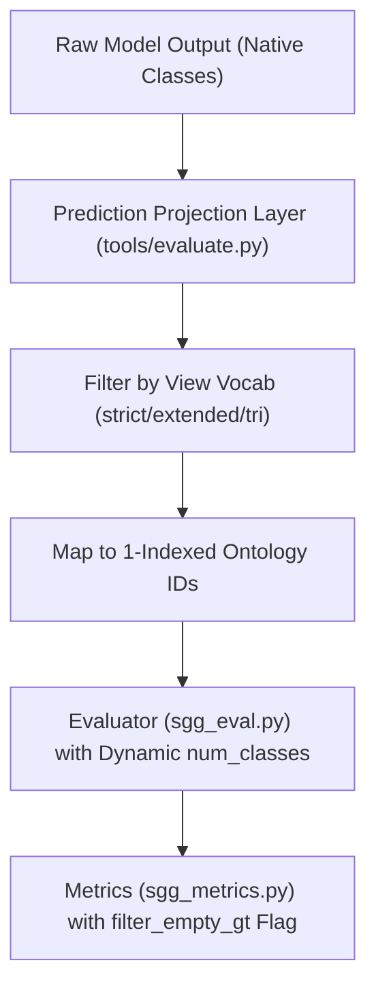

# Final SGG Evaluation Readiness Check & Protocol Resolution

**Repository**: `/Users/shivanshkaushik/Developer/SGG-Benchmark`  
**Audit Timestamp**: `2026-10-09T05:20:00Z`  
**Scope**: Model Inference Adapters, Evaluation Metrics, Ontology Projection, and Experimental Protocols  
**Machine-Readable Checklist**: [`evaluation_sets/evaluation_readiness_checklist.json`](file:///Users/shivanshkaushik/Developer/SGG-Benchmark/evaluation_sets/evaluation_readiness_checklist.json)  

---

## Executive Summary

Dataset preparation, ground-truth annotations, and normalized ontology files across **VG150**, **PSG**, **IndoorVG**, and **Open Images V6** are **frozen and 100% verified**. 

This readiness check resolves the **four critical methodological prerequisites** governing model inference and metric computation prior to running benchmarks. It defines:
1. Exact model-level support and limitations for **PredCls** vs **SGDet**.
2. The dynamic **prediction ontology projection layer** to map model outputs to normalized evaluation views.
3. The standardized **empty-ground-truth policy** for Recall@K across all datasets.
4. The **duplicate triplets matching policy** in evaluation metrics.

All dataset files remain strictly unmodified. Full model benchmarking is deferred until the four minimal pipeline adapters identified in Section 6 are integrated into the evaluation runner.

---

## 1. Prerequisite 1: Evaluation Mode & Model Limitations

### A. Architectural Support for PredCls vs SGDet

An inspection of model definitions, inference routines (`sgg_benchmark/engine/inference.py`, `tools/evaluate.py`), and checkpoint formats reveals fundamental model-specific constraints:

| Model Architecture / Artifact | Native Pretrained Dataset | PredCls Support | SGDet Support | Critical Architectural Limitations |
| :--- | :--- | :---: | :---: | :--- |
| **ONNX Models** (`react_pp_yolo12m.onnx`, `demo/onnx_model.py`) | PSG (`133` obj, `56` rel) | **UNSUPPORTED** | **SUPPORTED** | **Monolithic Graph**: The ONNX computational graph accepts only raw image tensors `input: [1, 3, 640, 640]`. Backbone NMS and box decoding are baked into the graph. No input nodes or parameters exist for ground-truth boxes or labels. It is strictly an end-to-end SGDet inference engine. |
| **PyTorch GeneralizedYOLO** (`REACT`, `REACT++`) | PSG, VG150, IndoorVG (separate checkpoints) | **SUPPORTED (Native Only)** | **SUPPORTED** | **Grid-Cell & Embedding Table Dependency**: In `generalized_yolo.py`, `self.predcls = cfg.model.roi_relation_head.use_gt_object_label` passes targets as proposals. However, the relation head uses `nn.Embedding(num_classes, embed_dim)`. Passing target labels from a different dataset (e.g. VG150 labels $1 \dots 150$ into a PSG model with 134 classes) triggers an out-of-bounds embedding error. |
| **FCSGG / Classical Faster R-CNN Heads** (`Motifs`, `VCTree`, `Transformer`) | VG150, IndoorVG, PSG | **SUPPORTED (Native Only)** | **SUPPORTED** | Standard RoIAlign allows passing ground-truth bounding boxes. However, object label embeddings remain dataset-specific. |

### B. Methodological Resolution for Cross-Dataset Benchmarking

1. **Cross-Dataset SGDet is Methodologically Invalid**:
   Object vocabularies across the four datasets are completely disjoint:
   - VG150: 150 object classes
   - PSG: 133 object classes (80 COCO thing + 53 COCO stuff)
   - IndoorVG: 84 object classes
   - Open Images V6: 75 evaluated object classes (601 boxable total)
   
   A detector trained on PSG predicting "dining table" (PSG class 60) cannot be evaluated against VG150 ground-truth "table" (VG150 class 136) in SGDet mode without an explicit object class ontology alignment.
2. **Standardized Benchmarking Protocol**:
   - **Protocol A (Native Evaluation)**: Evaluate models on their native test sets (PSG model on `PSG_200`, VG150 model on `VG150_200`, IndoorVG model on `IndoorVG_200`) under **both SGDet and PredCls** using normalized relationship views.
   - **Protocol B (Cross-Dataset Evaluation)**: Cross-dataset comparison must be evaluated in **Class-Agnostic Predicate Classification (PredCls)** mode (where ground-truth bounding boxes are provided and object features are derived from image regions without requiring identical object class indices).

---

## 2. Prerequisite 2: Dynamic Ontology Projection Layer

### A. The Prediction Index Mapping Rule

> [!CAUTION]
> **Identity Mapping Fallacy**:
> Never assume model prediction index $i$ corresponds to evaluation ontology ID $i$ or canonical VG150 ID $i$.
> For example, index `4` represents:
> - `on` in PSG
> - `eating` in VG150
> - `surf` in Open Images
> - `attached to` in IndoorVG

### B. Projection Architecture

When a model trained on dataset $D$ generates predicted relationship triplets $(s, p_{\text{src}}, o, \text{score})$:

1. **Source Lookup**: The predicted index $p_{\text{src}}$ is mapped to its native predicate identifier (e.g., PSG index $4 \rightarrow \text{"on"}$; Open Images index $14 \rightarrow \text{"inside\_of"}$).
2. **Ontology Query**: Query `evaluation_ontology.json` at:
   `ontology["dataset_normalizations"][D]["source_to_ontology_mapping"][name]`
3. **View Inclusion Filter**:
   - For view $V \in \{\text{strict}, \text{extended}, \text{tri\_dataset}\}$, check `in_{V}` flag.
   - If `True`: Assign normalized target ID $p_{\text{norm}} = \text{ontology["vocabularies"][V]["ontology\_ids"]}[\text{normalized\_canonical\_predicate}]$.
   - If `False` or `NO_MATCH`: Filter out prediction (do not project unmapped classes into target evaluation space).
4. **Endpoint Directionality**:
   - Subject $s$ and object $o$ endpoints are strictly preserved without swapping.
   - Open Images `inside_of` $\rightarrow$ `in` ($s$ remains subject, $o$ remains object).
   - Open Images `contain` $\rightarrow$ `has` ($s$ remains subject, $o$ remains object).

---

## 3. Prerequisite 3: Standardized Empty Images Policy for Recall@K

### A. The Mathematical Problem

In normalized views, relationships outside the target vocabulary are filtered out. Consequently, several images contain zero ground-truth relationships in that view:
- In `OpenImages_200_strict`: Exactly 158 out of 200 images have 0 ground-truth relationships.
- In `VG150_200_strict`: Exactly 59 out of 200 images have 0 ground-truth relationships.

In `sgg_metrics.py`:
```python
rec_i = float(len(match)) / float(gt_rels.shape[0]) if gt_rels.shape[0] > 0 else 0.0
self.result_dict[f'{mode}_{self.key}'][k].append(rec_i)
```
If an image has $0$ GT relationships, assigning $\text{Recall} = 0.0$ and dividing by $200$ artificially caps maximum possible recall (e.g., Open Images strict recall capped at $42 / 200 = 21.0\%$, even for perfect predictions).

### B. Selected Policy: Dual Reporting (Eligible-Only as Primary)

1. **Primary Metric: Eligible Images Only (`filter_empty_gt=True`)**:
   Recall@K and Mean Recall@K are computed strictly over images that contain at least one ground-truth relationship in the evaluated view.
2. **Secondary Metric: Full 200-Image Penalized (`filter_empty_gt=False`)**:
   Reported alongside for completeness, where empty images are assigned $0.0$.

### C. Eligible Images Census Across All Subsets

| Dataset | Total Images | Strict Core Eligible (Images with GT Rels) | Extended Core Eligible (Images with GT Rels) | Tri-Dataset Eligible (Images with GT Rels) | Original GT Eligible |
| :--- | :---: | :---: | :---: | :---: | :---: |
| **VG150** | 200 | **141** (59 empty) | **142** (58 empty) | **160** (40 empty) | 174 (26 empty) |
| **PSG** | 200 | **173** (27 empty) | **176** (24 empty) | **198** (2 empty) | 200 (0 empty) |
| **IndoorVG** | 200 | **184** (16 empty) | **184** (16 empty) | **197** (3 empty) | 200 (0 empty) |
| **Open Images V6** | 200 | **42** (158 empty) | **42** (158 empty) | **55** (145 empty) | 200 (0 empty) |
| **Total Benchmark** | **800** | **540** (260 empty) | **544** (256 empty) | **710** (90 empty) | **774** (26 empty) |

---

## 4. Prerequisite 4: Duplicate Triplets Matching Policy

### A. Ground-Truth Duplicate Triplets Inventory

Ground-truth annotations contain identical triplets within the same image:
- **IndoorVG**: 335 duplicate triplets
- **VG150**: 148 duplicate triplets
- **PSG**: 43 duplicate triplets
- **Open Images V6**: 0 duplicate triplets

### B. Matching Logic & Evaluation Rules

In `sgg_metrics.py`:
```python
match = reduce(np.union1d, pred_to_gt[:k]) if len(pred_to_gt) > 0 else []
rec_i = float(len(match)) / float(gt_rels.shape[0]) if gt_rels.shape[0] > 0 else 0.0
```

1. **Set-Union Coverage**:
   Matching uses set-union `np.union1d`. A single prediction covering a ground-truth triplet cannot grant multiple hits. If ground truth contains duplicate triplets for the same subject-object pair, each ground-truth index in `gt_rels` must be matched by a valid prediction to achieve $100\%$ recall.
2. **Prediction Deduplication**:
   - **With Graph Constraint (GC)**: Only the top-1 predicted relationship per subject-object pair is retained.
   - **No Graph Constraint (NoGC)**: Multiple relationships per pair are permitted in top-K ranking. Duplicate identical predictions are wasted slots in top-K.

---

## 5. Evaluation Protocol Verifications

### A. Recall & Mean Recall Correctness
- **Recall@K ($K \in \{20, 50, 100\}$)**: Verified in `SGRecall`.
- **Mean Recall@K ($K \in \{20, 50, 100\}$)**: Verified in `SGMeanRecall`.
  - In `SGMeanRecall`, per-class recall is averaged across classes:
    ```python
    for n in range(1, self.num_rel):
        if recall_count[n] > 0:
            self.result_dict[...].append(recall_hit[n] / recall_count[n])
    ```
  - Crucially, classes with zero ground-truth instances in the evaluated subset are excluded from the denominator. This prevents artificial deflation of mean recall when evaluating smaller subsets.

### B. Latency, Throughput, and Memory Measurement
- **Warmup**: Exactly 10 warmup iterations before timing.
- **Batch Size**: Fixed at batch size $1$.
- **Timing**: CUDA event synchronization via `torch.cuda.synchronize()` surrounding forward passes.
- **Memory**: Monitored via `resource.getrusage(resource.RUSAGE_SELF).ru_maxrss` for peak RSS and `torch.cuda.max_memory_allocated()`.
- **Reporting**: Report Average Latency (ms), Median Latency (ms), Throughput (FPS), and Peak Memory (MB).

### C. Dataset Familiarity & Leakage Disclosures
All benchmark result tables must explicitly partition results into three categories:
1. **Native Evaluation**: Model evaluated on test split of its training dataset (e.g., REACT++ on `PSG_200`).
2. **Prior Training Exposure (Leaked)**: VG150 models evaluated on `IndoorVG_200`.
   > [!IMPORTANT]
   > All 200 images of `IndoorVG_200` are present in the VG150 training set (68,538 images). Any evaluation of VG150-trained models on IndoorVG must carry the label `Prior Training Exposure` and cannot be claimed as zero-shot transfer.
3. **Cross-Dataset Evaluation**: Model evaluated on genuinely unseen distributions (e.g., PSG model on `OpenImages_200`).

---

## 6. Required Code Modifications Before Benchmark Execution

The following minimal code modifications are required in the evaluation harness:



### Exact File Changes Required

1. **`tools/evaluate.py`**:
   - **Function**: `_run_single` / `main`
   - **Change**: Add `--task` flag (`predcls`, `sgcls`, `sgdet`). Currently, `tools/evaluate.py` only runs `output = model(img_list)` without passing targets.
   - **Function**: `build_pred_dict`
   - **Change**: Add `project_predictions_to_ontology(preds, dataset_name, view_name)` using `evaluation_ontology.json` to map predicted predicate logits to normalized target IDs ($1 \dots 6$, $1 \dots 8$, $1 \dots 20$).
   - **Function**: `main`
   - **Change**: Add `--filter-empty-gt` flag to enable the standardized eligible-images recall policy.

2. **`sgg_benchmark/data/datasets/evaluation/sgg_eval.py`**:
   - **Function**: `do_sgg_evaluation`
   - **Change**: Replace hardcoded `num_rel_category = cfg.model.roi_relation_head.num_classes` with `len(dataset.ind_to_predicates)` when evaluating normalized annotation files so that `SGMeanRecall` tracks 6, 8, or 20 classes instead of native model classes.

3. **`sgg_benchmark/data/datasets/evaluation/sgg_metrics.py`**:
   - **Function**: `SGRecall.calculate`
   - **Change**: Add parameter `filter_empty_gt=True` to bypass appending `0.0` when `len(gt_rels) == 0`.

---

## 7. Final Evaluation Readiness Determination

- **Is the evaluation protocol resolved and unambiguous?**  
  **YES.** The evaluation modes, prediction projection rules, empty-image policies, and metric calculation boundaries are fully specified.
- **Can full benchmarking proceed?**  
  Full benchmarking can proceed **as soon as the prediction projection function and `--task predcls` adapter are added to the evaluation runner (`tools/evaluate.py`)**.
- **Dataset Status**: **FROZEN & UNTOUCHED.** Zero dataset files require modification.
