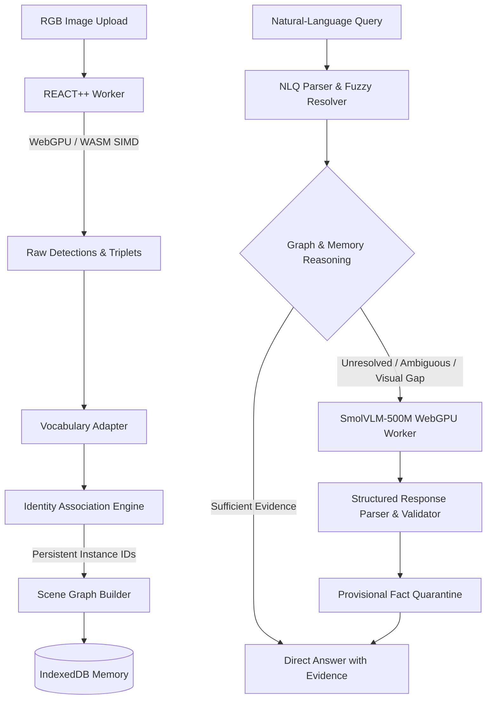

# System Architecture

**Project:** Object Retrieval in Dynamic Workspace Environments  
**Target:** Local-First Web Application (Browser & WebGPU/WASM)

---

## 1. High-Level Data Flow

---

## 2. Module Responsibilities

### UI Layer (`src/components/`, `src/app/`)
- Responsive interface built with React 19 + TypeScript.
- Real-time SVG/Canvas overlay for bounding boxes with interactive hover chips and directional relationship arrows.
- Dual-mode Scene Graph visualization (Interactive SVG Graph + Categorized Triplets List).
- Model Status Dashboard: Live indicators for Provider (`WebGPU`, `WASM`, `Local Service`), Latency Timers, Memory Counters.
- Query Console with example query chips, multi-stage reasoning status, and provenance badges.

### Model Layer (`src/models/`, `src/workers/`)
- **`SGGEngine` Interface:** Decouples inference provider from pipeline logic.
  - `ReactPlusPlusOnnxWebEngine`: Web Worker-backed ONNX Runtime Web session.
  - `ReactPlusPlusLocalEngine`: Fallback connection to optional localhost Python server (`127.0.0.1:8000`).
- **`VLMEngine` Interface:**
  - `SmolVLMExecuTorchEngine`: Lazy-loaded WebGPU ExecuTorch worker with OPFS caching and structured schema enforcement.

### Memory, Graph Reasoning & Logging Layer (`src/memory/`, `src/graph/`, `src/nlq/`, `src/logging/`, `src/utils/`)
- **`IndexedDB` Storage via `idb` (`workspace_retrieval_db` v2):** 11 object stores managing workspaces, sequences, frames, object instances, observations, relationships, graph change events, provisional VLM candidates, query history, app settings, and persistent session audit logs (`sessionLogs`).
- **`IdentityAssociation` + `VisualDescriptor`:** Re-identifies physical objects across frames via global 1-to-1 matching combining category/synonym compatibility, bounding-box IoU, normalized displacement, and scale-invariant RGB histogram/aspect-ratio similarity.
- **`NLQ Engine`:** Deterministic slot-filling parser + `Fuse.js` fuzzy matcher (`current`, `history`, `all`, `/sgg`, and `/visual` scopes) with interactive disambiguation and clickable `View Frame` provenance navigation.
- **`GraphReasoner`:** Traverses temporal scene graph facts across selected frames to answer object retrieval and comparative diff queries with exact frame provenance.
- **`SessionLogger` & `LogRepository`:** Non-blocking buffered audit trail tracking uploads, inferences, frame selections, deletions, queries, VLM calls, and errors, with JSON/CSV export inside `DiagnosticsPanel`.
